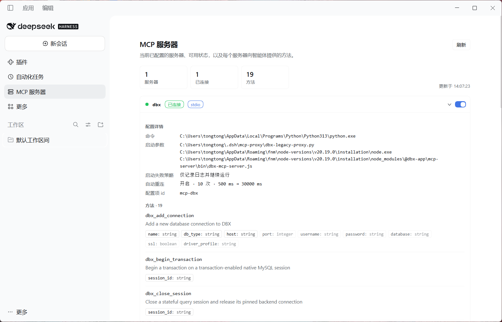

# dsh-mcp-inspector

[English](README.md) | 中文

给 DeepSeek Harness Web UI 增加一个**MCP 服务器面板**：左侧栏入口 → 中间面板列出当前 profile 里已配置的 MCP 服务器，显示实时可用状态，展开可查看完整配置与全部方法，并可在行内直接启用/停用某台服务器。



## 功能

- **左侧栏入口**：`MCP 服务器` 图标，点击打开全局面板。
- **服务器与状态**：每台服务器一行，显示已连接 / 暂无方法 / 已停用 / 加载失败 / 运行时注册。
- **展开看全部信息**：
  - 配置详情：传输方式 Tag（`stdio` / `streamable-http`）、命令、启动参数（逐行）、工作目录、端点 URL、请求头/环境变量**名称**（值隐藏）、调用超时、指令上限、启动失败策略、自动重连参数、配置项 id。
  - 方法列表：每个 MCP 工具的名称、完整描述、参数（必填高亮）。
- **动态开关**：行右侧开关，运行时启用/停用该服务器；停用后 MCP 连接关闭、方法从工具表移除，启用后自动重连。状态通过宿主官方 `pluginManager.setPluginEnabled()` 写入 profile 的 `cordis.patch.yml`，**重启后仍然生效**。
- **自动刷新**：打开面板时读取，每 15 秒轮询；切换开关后立即刷新并补一次。
- **主题与语言**：全部使用宿主主题 token，自动适配明暗主题；界面文案随宿主语言切换（中文/英文）。

## 运行环境

- DeepSeek Harness 0.2.x（Web GUI 或桌面端）。
- profile 已加载 base + web-app（web 界面）。
- MCP 服务器通过 [`@deepseek-ai/dsh-mcp-client`](https://github.com/deepseek-ai/deepseek-harness) 的配置行声明，例如在 profile 的 `cordis.patch.yml` 中：

```yaml
- insert:
    - id: mcp-github
      name: '@deepseek-ai/dsh-mcp-client'
      config:
        serverName: github
        transport: stdio
        command: npx
        args: ['-y', '@modelcontextprotocol/server-github']
```

## 安装

把本仓库 clone 到本地，然后在 Harness 里安装这个目录（二选一）：

1. **Web UI**：设置 → 插件 → 添加 → 选择本仓库的绝对路径（或粘贴路径），安装后启用。
2. **agent/CLI**：让 Harness 的 agent 执行 `plugin_manager install_bundle`，target 为仓库绝对路径；或使用
   `dsh plugin --profile <profile> add /absolute/path/to/dsh-mcp-inspector`。

安装后左侧栏出现 `MCP 服务器` 入口。改代码后要重新加载插件（在插件页停用再启用，或重启 Harness）。

## 页面用的 Host 接口

插件 Host 半只注册两个本机路由，没有公开配置项：

| 方法与路径 | 作用 |
| --- | --- |
| `GET /mcp-inspector/servers` | 只读清单：已配置服务器、状态、配置详情、方法列表 |
| `POST /mcp-inspector/toggle` | 启用/停用某行，body `{ "entryId": "<Loader 条目 id>", "enabled": true }` |

安全说明：

- 只绑定 Harness 自己的本机 Web 服务，不新开端口。
- `env`、`headers` 的**值不会离开 Host**，页面只显示名称。
- 开关接口仅接受 POST，要求自定义头 `x-mcp-inspector-action: toggle`（跨站表单无法携带），并拒绝跨站 `sec-fetch-site`；只允许切换清单中确实存在的 MCP 服务器行。

## 状态判定

| 状态 | 含义 |
| --- | --- |
| 已连接 | 配置行处于激活状态，且当前注册了该方法服务器的方法 |
| 暂无方法 | 行已激活，但没有注册任何方法（可能仍在连接，或服务器不提供工具） |
| 已停用 | 配置行被停用（本插件开关或 patch 里的 `disabled: true`） |
| 加载失败 | 配置行激活失败（例如启动命令错误） |
| 运行时注册 | 没有配置行、但运行时注册了方法的服务器 |

## 目录结构

```
.
├── package.json        # bundle 声明：dsh.bundle.patch + dsh.client（web）
├── cordis.patch.yml    # 插入 Host 行 mcp-inspector
├── index.js            # Host 半：清单 + 开关路由
├── client.js           # Client 半：侧边栏入口 + 主面板 React 页面
├── locale/{en,zh}.json # 插件显示标题/描述
├── icon.svg            # 插件图标
└── docs/screenshot.png # README 使用的面板截图
```

## 仓库元数据

- 包元数据已指向 `github.com/zwgblue/dsh-mcp-inspector`；如果你 fork 了本项目，请同步修改 `package.json` 里的三处地址（`homepage` / `repository` / `bugs`）。
- 如需要 npm 发布：把包名改成你的作用域（例如 `@you/dsh-mcp-inspector`），同时修改 `cordis.patch.yml` 里的 `name` 和 `client.js` 顶部的模块 id。
- `LICENSE` 中的版权人/年份可按需修改（当前为 `2026 zwgblue`）。

## License

MIT
